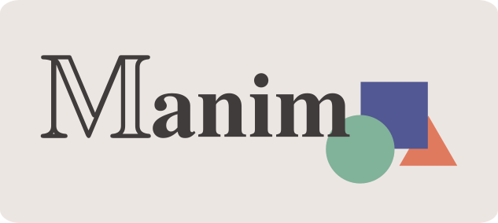

# Manim Animation Workflow 🎥

Welcome to the **Manim Portable Studio**! This repository is a self-contained environment for creating professional math and science animations using the Manim Community library.

## 🚀 Quick Start
1.  **Clone** this repository.
2.  Double-click **`setup.bat`** (Only needed the first time).
3.  **Drag and drop** any `.py` file from the `model/` folder onto **`render.bat`** to see the magic.

## 🧹 Housekeeping
*   Use **`clean.bat`** to wipe the `media/` folder and save space.
*   Keep your images and icons in the **`assets/`** folder.

## 📁 Repository Structure
*   `assets/`: Media files (images, sounds, etc.)
*   `model/`: Your Python animation scripts.
*   `portable_env/`: (Hidden) The self-contained Python and LaTeX tools.
